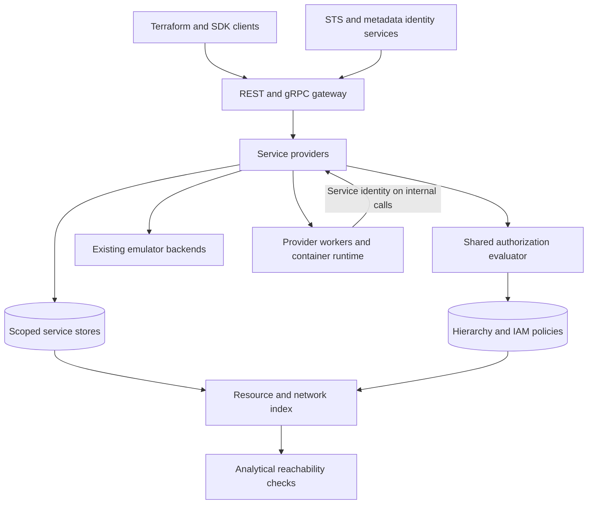

# gcp-local

Oct 2, 2026 · @Evan Marshall

## Summary

gcp-local is a local GCP emulator built around LocalStack's proven structure: a shared API gateway, generated API contracts, service providers, scoped state stores, and reusable emulator backends. Identity, IAM enforcement, and a networking control plane extend that structure. The goal is that supported workloads, tests, and Terraform resources behave like real GCP, with measured permission fidelity and explicit network reachability assertions. Analytical network checks do not enforce the paths taken by local containers.

The closest existing project, [localgcp](https://github.com/slokam-ai/localgcp), is data-plane only. Its README lists IAM/auth enforcement as not included (all requests are accepted), and its Cloud Run is record CRUD with no container execution or revisions. It has no Compute or VPC APIs. Its services are still useful as backends behind our proxy.

The defining bet: IAM behavior verified against real GCP and shipped as versioned rules and conformance fixtures. A method→permission table handles common checks; service providers supply request- and state-dependent checks. Begin with recorded scenarios for supported workflows and expand automated permission probing incrementally.

## LocalStack architecture baseline

The reference is the archived [LocalStack repository at commit 8b9a79f](https://github.com/localstack/localstack/tree/8b9a79f05846835cf4dff63ab7eefdde9df83783), optionally checked out at `../localstack`. Follow its provider architecture and add abstractions only when a concrete GCP behavior needs them. This adopts the architecture without committing to a language choice or a fork of the AWS-specific implementation. See the [source comparison](localstack-comparison.md) and [implementation roadmap](roadmap.md).

| LocalStack pattern | gcp-local equivalent |
| --- | --- |
| Gateway handler chain and request context | REST/gRPC entry points with method, principal, project, location, and trace context |
| Generated API stubs and service providers | Generated GCP contracts; ordinary provider methods implement semantics |
| Moto and HTTP backend fallback | Forward supported operations to existing emulators; override only identified gaps |
| Account/region stores and provider state hooks | Service stores scoped by project and the API's global, regional, or zonal semantics; coordinated reset/save/load |
| Service loading and backend lifecycle hooks | Explicit provider registry, lazy backend startup, readiness, shutdown, and reset |
| SNS delivery and Lambda runtime implementations | Provider-owned Pub/Sub/Tasks delivery and Cloud Run container execution |
| AWS-recorded snapshot tests and Terraform acceptance tests | GCP-recorded fixtures replayed locally; a versioned allowlist of google-provider acceptance tests |



Providers enforce authorization before side effects or backend forwarding. Provider workers carry their service-agent identity through the same authorization interface. Keep these components in one core runtime initially; separate processes are for emulator backends and workloads that require them. A general workflow engine, distributed event bus, or universal resource database is not required.

Each resource field has one owner: a provider store or an emulator backend. The shared graph holds hierarchy, policies, resource references, and network facts needed across services; it does not duplicate every backend's database. Providers publish graph changes at defined lifecycle transitions and define cleanup or reconciliation for partial backend failures. Reset and restore cover provider state, graph entries, and backend assets together; providers that cannot restore their backend report that limitation.

The archived gateway is not a reference implementation of comprehensive IAM enforcement: it includes a missing-auth-header injector, and its IAM provider includes a basic policy simulator. Strict GCP authorization is an intentional addition. See the [gateway](https://github.com/localstack/localstack/blob/8b9a79f05846835cf4dff63ab7eefdde9df83783/localstack-core/localstack/aws/app.py) and [auth handler](https://github.com/localstack/localstack/blob/8b9a79f05846835cf4dff63ab7eefdde9df83783/localstack-core/localstack/aws/handlers/auth.py).

## Goals and non-goals

Goals:

- Catch IAM bugs locally. For supported scenarios, a call by principal P on resource R matches GCP's decision and recorded error contract, including the missing-permission name when GCP supplies it.
- Catch networking bugs locally. "Can workload A reach B:port?" is answered the way GCP's Connectivity Tests would answer it, from the same config.
- Run the Terraform google provider against local for the supported resources. Plan, apply, and destroy behave like real GCP, including validation errors and long-running operations.
- Use standard client libraries and workloads with documented endpoint and credential configuration. Certify combinations of SDK language/version, transport, and identity mechanism before claiming no code changes.
- Measure fidelity. Every behavior claimed as verified has a recorded real-GCP scenario; regressions against those fixtures fail CI. Record functional support and authorization coverage separately.

Non-goals for v1:

- Data-plane reimplementation. Pub/Sub, GCS, Spanner, Firestore, etc. come from existing emulators.
- Packet-level network simulation. Reachability is analytical first. Real packets are a later option.
- Performance, quota, and billing fidelity.
- Full API surface coverage. Coverage is driven by what real workloads and Terraform modules touch.

## Identity and token minting

Every request reaching gcp-local resolves to a known principal or an explicit unauthenticated caller. Missing credentials do not imply an administrator identity; public access is decided by the supported service's policy. Callers use standard ADC and metadata-server mechanisms through configurations verified for their SDK.

| Caller | Mechanism | How it resolves locally |
| --- | --- | --- |
| Developer / test runner | ADC file of type `external_account` | `token_url` points at the local STS; subject token names the principal (e.g. `user:dev@local`) |
| Workload "running as" an SA | Metadata server via `GCE_METADATA_HOST` | Per-workload metadata endpoint returns tokens for the SA the workload is configured with (Cloud Run service account, VM SA) |
| Impersonation | `iamcredentials.generateAccessToken`, `signJwt`, `generateIdToken` | Gated on `iam.serviceAccounts.getAccessToken` / `signJwt` / `getOpenIdToken` against the target SA's policy |
| Terraform | ADC or `impersonate_service_account` in the provider | Same paths as above; endpoint overrides via `*_custom_endpoint` |
| SA keys | JSON key file | Supported but subject to the `iam.disableServiceAccountKeyCreation` org policy, as in prod |

Tokens are opaque handles (`gl.<random>`) mapped server-side to principal, delegation chain, scopes, and expiry. Short default lifetimes (1h, configurable down to seconds) surface refresh bugs. ID tokens are real signed JWTs from a local JWKS, so services verifying audience and issuer can be tested.

Traffic interception has two modes:

- **Endpoint override** (default). Use `api_endpoint` and provider custom endpoints with credentials enabled and the transport configuration required by the SDK. Use `*_EMULATOR_HOST` only where the SDK preserves the identity behavior being tested. For example, Python Pub/Sub selects anonymous credentials in emulator mode; that configuration cannot validate ADC identity. Track these differences in the SDK compatibility matrix. [Client source](https://github.com/googleapis/python-pubsub/blob/main/google/cloud/pubsub_v1/publisher/client.py)
- **Transparent** (opt-in). Local DNS resolves `*.googleapis.com` to the gateway, which serves certs from a local CA that's trusted in the container image or dev machine. Needed for code and tools that can't be pointed at a custom endpoint.

## IAM evaluation engine

The engine answers one question: given principal P, permission checks S, their target resources, and request context C, is the call allowed? Its diagnostic record explains the decision; providers format the externally visible error according to recorded service behavior. The following are evaluation concerns, not a universal first-denial order. Google documents IAM policy types as evaluated simultaneously; error precedence across IAM, service enablement, VPC-SC, validation, and org policy is verified per scenario. [IAM evaluation](https://docs.cloud.google.com/iam/docs/policy-types#policy_evaluation)

1. **Service enablement.** Is the API enabled on the consumer project selected by the service's request and credential rules? Record when that differs from the resource project. Model `SERVICE_DISABLED` for verified cases.
2. **VPC Service Controls.** Is R inside a perimeter, and is the caller or source outside it without a matching ingress/egress rule? Fails with a VPC-SC violation, not a plain 403.
3. **Org policy constraints.** These are evaluated on create/update (e.g. `compute.vmExternalIpAccess`, `iam.allowedPolicyMemberDomains`, `gcp.resourceLocations`).
4. **Deny policies.** Attached at org/folder/project. Matching denied permissions win regardless of allows.
5. **Principal access boundary policies.** These limit which resources a principal is even eligible to access.
6. **Allow policies.** The union of bindings from R up through its ancestors (resource → project → folders → org). Roles are expanded to permissions, and IAM Conditions are evaluated in CEL against `request.time`, `resource.name`, `resource.type`, and other attributes.

Data model:

- **Resource hierarchy.** Org, folders, projects, then resources. Each resource has its canonical full name (`//storage.googleapis.com/projects/_/buckets/b`) and a parent pointer.
- **Roles.** Predefined roles snapshotted from the real `roles.list` and `roles.get` (with `view=FULL`), versioned and refreshed weekly. Custom roles are stored at org or project level. Roles that are deprecated or in launch stages behave as they do in prod.
- **Principals.** Users, groups (with local membership), service accounts (including Google-managed service agents), `allUsers`/`allAuthenticatedUsers`, and workload/workforce identity pool principals.

Realism toggles:

- **Propagation delay.** Off by default. When on, policy changes become visible at scheduled, seeded delays per check site. This exercises grant-then-use races reproducibly; it is not a claim to reproduce GCP's propagation distribution.
- **Strict authorization** (default). Fail explicitly on an unsupported method, request feature, or policy construct needed for the decision. Any future permissive development mode must be opt-in, label authorization as unchecked, and must not produce conformance passes.

Every decision is logged as a structured audit record: principal, method, resource, permissions checked, result, and deciding policy. This doubles as a Policy Troubleshooter: `gcp-local why-denied <request-id>`.

## Method→permission table and probing harness

The permission table records verified checks for an API method and scenario, including each target resource. Providers combine baseline checks with request- and state-dependent checks and invoke the shared evaluator. Simple cases use declarative entries; complex cases use ordinary provider code with conformance tests. A new general-purpose policy language is not a prerequisite. Google's docs seed the rules; real sandbox scenarios verify them within their recorded preconditions.

### Why request shape matters

One method can check different permissions depending on its arguments. For example, `compute.instances.insert` needs checks for instance creation and, where applicable, disk creation, subnet use, external IP use, service-account attachment, and image use. Permissions can also depend on existing state: replacing a Storage object needs both `storage.objects.create` and `storage.objects.delete`. Providers resolve these facts and compose all applicable checks, rather than selecting one winning shape. [Compute insert](https://docs.cloud.google.com/compute/docs/reference/rest/v1/instances/insert), [Storage permissions](https://docs.cloud.google.com/storage/docs/access-control/iam-permissions)

### Table schema

Illustrative subset only; this is not a complete or probed permission entry. Feature flags and target resources below are resolved by provider code, with the resource where a role can be granted recorded separately by the probe fixtures.

```yaml
method: compute.instances.insert          # API method id (discovery or proto full name)
api_version: v1
checks:                                  # all applicable checks compose
  - permission: compute.instances.create
    on: resolved.instance_create_target
  - permission: compute.subnetworks.use
    when: uses_subnetwork
    on_each: resolved.subnetworks
  - permission: compute.subnetworks.useExternalIp
    when: uses_external_ip
    on_each: resolved.external_ip_subnetworks
  - permission: compute.instances.setServiceAccount
    when: attaches_service_account
    on: resolved.instance_permission_target
  - permission: iam.serviceAccounts.actAs
    when: attaches_service_account
    on_each: resolved.service_accounts
  - permission: compute.disks.create
    when: creates_disks
    on_each: resolved.disk_create_targets
error_on_deny: {code: 403, reason: forbidden, message_template: "Required '{permission}' permission for '{resource}'"}
provenance: {status: illustrative, probed_at: null, harness_run: null}
```

### Probing algorithm

For each (method, request features, initial state, acting identities) scenario:

1. **Fixture.** Terraform creates the minimal prerequisite resources in a fresh probe project: network, subnet, SA, image, etc. Fixtures are per-method modules, reused across shapes.
2. **Zero-permission principal.** Mint a probe SA holding no roles anywhere. It gets permissions only through a custom role bound by the harness.
3. **Loop.** Call the method as the probe SA. Parse a missing permission and its target, then grant at a supported policy attachment point, which can differ from that target. Use `testIamPermissions` where available as a readiness hint, then retry the actual operation. Bound propagation waits and record an inconclusive result on timeout. Handle permissions unavailable in custom roles explicitly. Keep caller and service-agent grants separate.
4. **Complete.** Poll long-running operations and observe required asynchronous effects before declaring success. Record non-IAM failures as separate validation cases; they do not establish permission completeness.
5. **Minimize.** Restore equivalent initial state before each trial, remove one discovered permission, wait for revocation, and verify the expected authorization failure. An `ALREADY_EXISTS` response or unrelated validation error is not evidence that the permission was required. Confirm restoration returns the scenario to success.
6. **Record** the verified permission set, check targets, grant locations, acting identities, fixture preconditions, and normalized outcomes. This establishes behavior for the tested scenario, not all alternate authorization paths. Preserve provenance and inconclusive trials separately.
7. **Teardown.** Delete the probe project, or recycle it from a warm pool.

Seeding and shape discovery:

- Seed shapes from the Terraform provider's acceptance-test configs and from request logs of real workloads run in record mode.
- Seed expected permissions from Google's per-method permission docs and from `queryTestablePermissions`. This narrows the search and flags undocumented checks when the probe disagrees.
- Error messages aren't uniform across APIs. Some name the permission, some only the resource, and some return 404 instead of 403 to hide existence. Per-API parsers handle each. When a parse fails, fall back to granting candidate permissions from the seed set in bisection.

### Operations

| Concern | Approach |
| --- | --- |
| Cost | Dedicated billing account, budget alerts, per-run resource limits, teardown, and a cleanup sweep for failed runs |
| Propagation latency | Start with targeted scenarios and a configurable project pool; size concurrency from measured latency, quotas, and cost before attempting broad rebuilds |
| Drift detection | Nightly: re-run a sampled 10% of entries plus all entries for APIs with new discovery revisions; any diff opens a PR against the table |
| Coverage tracking | Report methods and request/state features without verified coverage; strict authorization rejects unsupported decisions |
| Safety | Use a dedicated probe org, controlled fixture grants, and an allowlist of probe projects. Org-attached deny policies affect descendant resources; they do not constrain access granted in other organizations |

## Control-plane resource graph

The control plane uses generated API servers and service providers, with typed service stores and a shared resource graph for cross-service queries. Terraform must get the same answers for supported resources that it gets from GCP: compatible IDs, validation errors, and operation lifecycles. Preserve service-specific ownership and lifecycle semantics rather than requiring every service to use one universal persistence model.

The resource list below is the intended v1 scope, delivered incrementally through verified workflows. A provider can initially forward to an emulator and gain custom handlers as recorded gaps require them. Availability of one useful service does not wait for completion of every IAM or network feature.

| API | v1 resources | Notes |
| --- | --- | --- |
| Resource Manager v3 | organizations, folders, projects, tag keys/values/bindings | Hierarchy feeds IAM inheritance and org policy |
| IAM v1 / v2 / v3 | roles, service accounts, SA keys, deny policies, workload identity pools, principal access boundary policies/bindings | PAB uses v3; plus `getIamPolicy`/`setIamPolicy`/`testIamPermissions` on supported resource types |
| IAM Credentials v1 | generateAccessToken, signJwt, generateIdToken | Backs impersonation |
| Service Usage v1 | services enable/disable | Drives `SERVICE_DISABLED` |
| Org Policy v2 | policies, constraints | Boolean and list constraints first; custom constraints later |
| Access Context Manager v1 | access policies, perimeters, access levels | VPC-SC |
| Compute v1 (networking) | networks, subnetworks (+ secondary ranges), firewalls, network and hierarchical firewall policies, routes, routers + NAT, peerings, addresses, global addresses (PSA ranges), forwarding rules / PSC endpoints, service attachments | REST/discovery-only API |
| Service Networking v1 | connections (private service access) | Peering to producer VPCs for Cloud SQL, Memorystore |
| Cloud Run v2 | services, revisions, jobs | Records SA identity, ingress setting, VPC egress config; execution via local containers |
| Cloud SQL Admin v1 | instances (IP config only, plus a backing Postgres container) | Private IP via PSA range |

Implementation rules:

- **Generate, don't hand-write, the API surface.** gRPC services come from the [googleapis](https://github.com/googleapis/googleapis) protos. Compute and other REST-only APIs come from discovery docs. Handlers implement only semantics.
- **Long-running operations** follow each API's shape: zonal, regional, and global operations for Compute, `sql#operation` for Cloud SQL, and `google.longrunning.Operation` where the API specifies it. Providers own state transitions; shared helpers can handle scheduling and polling. Completion follows the underlying work, with deterministic optional delay for tests. [Cloud SQL operations](https://docs.cloud.google.com/sql/docs/postgres/admin-api/rest/v1/operations)
- **Fingerprints and etags** are enforced on update. A stale fingerprint fails as in prod, which catches concurrent-modification bugs.
- **Validation** is modeled on real errors captured by the harness: CIDR overlap across subnets and peered networks, secondary range conflicts, region mismatch, delete-with-dependents (`resourceInUseByAnotherResource`), name format, and the 63-char limit.
- **selfLinks and IDs** use real formats (numeric IDs plus `https://www.googleapis.com/compute/v1/...` selfLinks), since the provider parses them.
- **Default resources.** A new project gets the `default` network with auto-mode subnets and the four default firewall rules, unless the `compute.skipDefaultNetworkCreation` org policy is set, as in prod.

## Network reachability engine

v1 computes reachability analytically from the control-plane graph, in the same style as GCP's Connectivity Tests. A query takes source, destination, protocol, and port and returns a verdict with the hop-by-hop trace and the deciding rule at each hop. Results distinguish reachable, dropped, unknown, and unsupported. Container connectivity is a separate runtime observation; a successful local socket connection does not establish GCP network parity.

```
gcp-local net check --from run/api@us-central1 --to sql/main:5432
✗ DROPPED at egress: Cloud Run 'api' has no VPC egress configured;
  10.40.0.3 (PSA range) is not reachable via the internet route
```

The evaluation pipeline for one flow:

1. **Resolve endpoints.** Map each workload to its network attachment: VM NIC, Cloud Run direct VPC egress subnet or Serverless VPC Access connector range, GKE pod/node ranges, PSC endpoint, or producer-side IP for PSA services.
2. **Egress firewall at source.** Evaluate in this order: hierarchical firewall policies (org, then folder, with `goto_next`), then the network firewall policy and VPC firewall rules in the configured enforcement order, by priority. Targets match on network tags, target SAs, or secure tags. The implied allow-all egress rule applies last.
3. **Route selection.** Apply GCP's route-category precedence before longest-prefix and priority rules within the relevant category. Cover subnet, static, peering-imported, and explicitly modeled learned dynamic routes. Cloud Router advertised prefixes describe outbound advertisements, not learned routes. Unmodeled policy-based or dynamic routing produces an unsupported or unknown result. [Routing order](https://docs.cloud.google.com/vpc/docs/routes), [advertised routes](https://docs.cloud.google.com/network-connectivity/docs/router/concepts/advertised-routes)
4. **Path checks.** Peering is **not transitive**: a route learned from peer B is never re-exported to peer C. For a modeled direct internet-gateway path, an instance without an external IP needs eligible Cloud NAT configuration. Evaluate Google API access using the selected endpoint, routes, Private Google Access, NAT, or PSC configuration as applicable, rather than one universal requirement. VPC-SC evaluation also requires request and identity context; a port-only query cannot establish API authorization.
5. **Ingress firewall at destination.** Same policy order as egress. The implied deny-all ingress rule applies last. GFE and health-check ranges (`35.191.0.0/16`, `130.211.0.0/22`) are modeled for load-balancer flows.
6. **Destination listening.** Optional: if the destination is a running local container, confirm the port is bound.

Assertions in tests:

```yaml
reachability:
  - from: run/api
    to: sql/main:5432
    expect: reachable
  - from: vm/bastion
    to: internet:443
    expect: dropped          # no NAT on purpose
```

These assertions run in CI against a materialized graph. Analysis of a Terraform plan needs an importer that merges planned changes with prior state and resolves defaults and references; unresolved computed values remain unknown. CI can require a conclusive expected verdict. Analytical checks must be invoked explicitly until runtime network enforcement exists.

Packet-level mode, later and opt-in: subnets map to Linux bridges in network namespaces, compiled firewall rules map to nftables, and Cloud Run services and VMs run as containers attached to those namespaces. Its value is end-to-end tests with real traffic. Its cost is subtle divergence from GCP's distributed firewall (connection tracking, implied rules, metadata server at 169.254.169.254). Every packet-level verdict is cross-checked against the analytical engine, and a disagreement is a bug in one of them.

## Service providers and data-plane forwarding

Data-plane services run on existing emulators behind the gateway and service providers, following LocalStack's provider-plus-backend pattern. Providers reuse backend behavior and add the smallest handlers needed for IAM, validation, and integration gaps. Backend reuse reduces reimplementation; it does not automatically supply missing asynchronous behavior or protocol coverage.

For a forwarded API request, the gateway and provider:

1. Authenticate the bearer token or supported service-specific credential to a principal; preserve explicit anonymous access where the service supports it.
2. Decode the method. For gRPC this comes from the path. For REST it comes from route templates generated from discovery docs, plus the request body where shape features need it.
3. Resolve permission checks from the table and provider-specific request/state logic, then evaluate them with the IAM engine before mutations or forwarding.
4. On deny, return the GCP-shaped error. On allow, translate credentials as required by the selected backend and forward the request.
5. Serve metadata operations the backend does not implement. For example, the bucket's IAM policy lives in gcp-local, not in fake-gcs-server, so `storage.buckets.getIamPolicy` is served by the Storage provider.

Providers own background work where required: Pub/Sub and Cloud Tasks delivery, operation completion, and Cloud Run revisions and container lifecycle. Use ordinary provider workers and shared runtime helpers, as LocalStack does for SNS and Lambda. Calls to another service carry the acting service-agent identity and pass its authorization checks. Forwarding must preserve streaming, cancellation, deadlines, and service-specific error details for the transports claimed as supported.

| Service | Backend | Provider responsibilities beyond the backend |
| --- | --- | --- |
| Pub/Sub | Official emulator | IAM on topics/subscriptions; push subscription OIDC tokens minted by gcp-local |
| Cloud Storage | fake-gcs-server | Bucket/object IAM, uniform bucket-level access, signed URL verification against the signing SA |
| Firestore | Official emulator | IAM (not security rules) for server-side clients |
| Spanner / Bigtable | Official emulators | IAM at instance/database/table level |
| BigQuery | goccy/bigquery-emulator or LocalBQ | Dataset/table IAM; `bigquery.jobs.create` on the job project vs. data access on the dataset project |
| Secret Manager, KMS, Cloud Tasks | localgcp services | IAM; Cloud Tasks OIDC tokens for HTTP targets |
| Cloud SQL / Memorystore | Postgres / Redis containers | `cloudsql.instances.connect` via a local Cloud SQL Auth Proxy shim; IAM DB auth later |

`gcp-local up` manages the core and backend containers in one Compose project. Providers start optional backends lazily or through an explicit preload list, report readiness and health, and implement shutdown/reset hooks. API backend ports stay private, and workload networks must not provide a direct bypass to them. SQL and Redis require explicit protocol-specific endpoints or connectors; the HTTP/gRPC gateway cannot carry every database protocol. These endpoints declare which connection authorization they enforce and do not imply packet-level GCP networking.

## Conformance and fidelity

Use LocalStack's snapshot-testing workflow: execute scenarios against the real cloud to record expected behavior, then run ordinary development and CI tests locally against the committed fixtures. Every behavior claimed as verified has a real-GCP recording; regressions against that contract fail CI. Broader functional coverage can ship incrementally with explicit verification status.

- **Differential suite.** The same scenario runs against either real GCP (for recording/revalidation) or gcp-local (for normal CI). A scenario includes fixtures, API calls as named principals, cleanup, and optionally Terraform configuration. Compare status codes, error reasons, missing-permission names, and normalized response bodies. Preserve reference relationships when normalizing IDs; assert etag and lifecycle behavior separately so normalization does not hide defects.
- **Record mode.** `gcp-local record` proxies to real GCP and captures candidate request/response fixtures with credentials and sensitive payloads redacted. Turning a capture into a repeatable scenario still requires prerequisites, identity setup, reference substitution, and cleanup. Captures also identify new shapes for the probing harness.
- **Terraform compatibility.** Pin the google provider version and run an allowlisted set of its acceptance tests, following LocalStack's existing approach. Include create/read/update/delete, refresh, operation polling, and a second plan with no unexpected diff. Expand the allowlist with verified coverage.
- **Reachability conformance.** For each network topology fixture, run GCP Connectivity Tests in the sandbox and assert the same verdict and deciding rule from the local engine.
- **Fidelity score.** Published per API: functional methods, verified request/state scenarios, IAM coverage, backend version, last successful real-GCP validation date, and known divergences. A backend-success result does not by itself establish authorization fidelity.
- **Cadence.** Run fast local acceptance tests on changes and the full local conformance suite nightly. Revalidate targeted and sampled scenarios against GCP on a separate schedule. Discovery revisions, backend updates, and predefined-role diffs trigger relevant re-probes. Ship pinned rules, role snapshots, backend versions, and fixtures; live drift proposes a reviewed update rather than changing a developer's environment implicitly.

Known-divergence policy: an unsupported authorization decision fails explicitly with a pointer to the gap and is distinct from an emulated GCP denial. Known functional differences are published per provider and excluded from parity claims; supported baseline operations can still run. Unknown network paths never count as reachability passes.

## Risks and open questions

The largest risk is false confidence: a local allow that prod denies. Every design choice above leans toward failing closed for that reason.

| Risk | Impact | Mitigation |
| --- | --- | --- |
| Permission table incomplete or stale | Tests pass, prod 403s | Strict mode in CI; nightly drift probes; coverage report per API |
| Undocumented check order (VPC-SC vs. IAM vs. org policy) | Wrong error surfaced, debugging misled | Capture the order from harness runs that combine failures; don't assume |
| Error messages don't name the permission for some APIs | Harness can't discover the set automatically | Per-API parsers; bisection over seed permissions |
| Probe cost and propagation latency | Slow, expensive table builds | Warm project pool, parallelism, sampled nightly re-probes |
| Compute API breadth | Control plane never "done" | Coverage driven by record mode and Terraform modules actually in use |
| Google changes behavior silently | Fidelity decays | Discovery-revision and role-snapshot diffs trigger re-probes |

Open questions:

- [ ] License and distribution of the permission table: open, or the paid part?
- [ ] GKE in scope? It adds Kubernetes RBAC plus Workload Identity, which is a large surface.
- [ ] Groups: local-only membership, or sync from Cloud Identity for realistic group-based grants?
- [ ] Ship packet-level mode at all, or stop at analytical reachability plus real containers on a flat network?
- [ ] Terraform provider version range to certify against.
