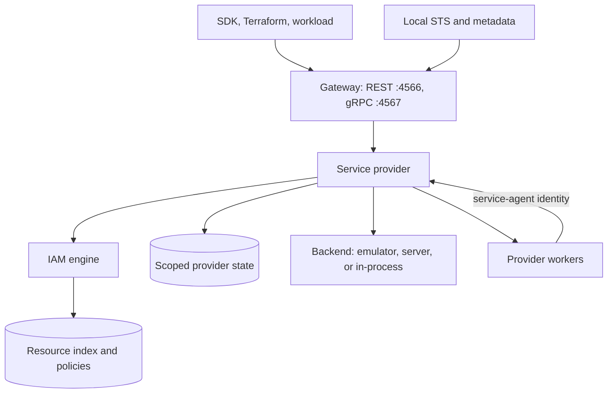

# Design

gcp-local is one Go process that serves GCP REST and gRPC APIs locally, authenticates every caller, checks IAM before any side effect, and hands the work to a service provider. Providers keep their own scoped state and reuse existing emulators or real servers as backends. Real-GCP recordings are the test oracle. The structure follows LocalStack; [the comparison](architecture/localstack-comparison.md) maps each part to its source. [Service coverage](coverage.md) says what each provider serves.

## Request path

1. The gateway matches a generated route, decodes the request, and resolves the bearer token to a principal.
2. The provider resolves the target resource and any request or state features (for example, whether an object already exists).
3. The provider calls the IAM engine with its registered permission plan. A deny returns the recorded GCP error shape; an unsupported decision fails closed.
4. Only after an allow does the provider mutate state or call its backend, inside `Manager.Use`.
5. The provider publishes resource-index changes after backend success.

## Gateway

`internal/gateway` owns route matching, transport decoding, error serialization, and request context. It knows nothing about service semantics.

- Every request carries its method, principal state, caller project, resource project and location, resource name, trace ID, and cancellation context. Caller project and resource project are separate fields.
- Absent credentials are anonymous; unknown or expired tokens are unauthenticated. Neither ever becomes an administrator.
- Providers register methods explicitly. A duplicate, misspelled, or wrong-streaming registration fails at startup. Unregistered methods return `UNIMPLEMENTED` (HTTP 501).
- REST matching unescapes each path variable once, so object names keep slashes, `%`, and `?`. JSON bodies are capped at 2 MiB and must be objects; uploads stay streams. The `Authorization` header is removed before the provider sees the request.
- gRPC uses Google's generated messages. Streaming calls read the first request to find the resource, then pass it to the provider once; deadlines and cancellation stay on the original stream.
- A REST-only provider can serve gRPC by transcoding: the gateway turns the call into the REST request its `google.api.http` binding describes and returns the REST result as the gRPC response (Secret Manager, Cloud Tasks, Cloud KMS). The provider and its permission plans see one request shape.
- A valid W3C `traceparent` propagates; otherwise the gateway generates one and returns it as `x-gcp-local-trace-id`.
- `/_local/health` and `/_local/diagnostics` bypass provider dispatch and never call a backend. Shutdown drains both listeners under one deadline, then cancels what remains.

## Generated API contracts

`tools/genapi` generates `api/generated/` from pinned discovery documents in `api/discovery/` and from Google's published protobuf descriptors in `go.mod`. Generated routes and stubs are transport contracts only: a route does not mean a provider serves it. Fix wrong output in the generator or its inputs, never by hand. `sh scripts/go.sh run ./tools/genapi -check` fails when committed output differs. [api/README.md](../api/README.md) lists every input and the handwritten exceptions.

## Providers and backends

Each service is a package under `internal/providers/`. A provider implements GCP semantics: validation, IAM, long-running operations, and anything its backend lacks. It reuses the backend for everything the backend already gets right.

| Backend kind | Examples | Who owns the data |
| --- | --- | --- |
| Official emulator, child process | Pub/Sub, Firestore, Spanner | Emulator owns messages and documents; provider owns what the emulator lacks (push config, field config) |
| Embedded emulator code | Storage (fake-gcs-server), Bigtable (bttest), BigQuery (googlesqlite) | Backend owns object, row, or table bytes; BigQuery's provider owns datasets and table metadata |
| Real server per instance | Cloud SQL (PostgreSQL, MySQL), Memorystore (Redis) | Server owns the database; provider owns instance metadata |
| In-process model | Secret Manager, KMS, Cloud Tasks, Compute, and others | Provider |

Rules:

- Clients never reach an API backend directly. Backend ports stay private. Cloud SQL and Redis expose their wire protocols on an explicit `-data-ports` range; those listeners forward bytes and the server enforces its own auth.
- Providers own background work: Pub/Sub push, Cloud Tasks dispatch, Cloud Scheduler jobs, operation completion, Cloud Run revisions. A worker calls other services as its service agent, through the same IAM checks. It never gets an implicit administrator identity.
- Shared helpers go in `internal/providers/provider` only when every caller renders byte-identical output.
- `internal/providers/compute` answers reachability analytically from the configured network graph ([networking](services/networking.md)). A local socket connection is not evidence of GCP reachability.

## IAM engine

`internal/iam` answers one question: may this principal perform these permission checks on this target? Details are in [the IAM guide](architecture/iam.md).

- Each provider registers a permission plan per method: baseline permissions plus permissions added by named request or state features. A plan cannot drop baseline checks. An unresolved feature is an error, not an assumption.
- Evaluation walks the target's ancestry in the resource index (resource, project, folder, organization) and unions allow bindings. It also evaluates IAM conditions (CEL), deny rules, and principal access boundary policies.
- Roles come from committed snapshots of real predefined roles in `internal/iam/roles/`, checked against `manifest.json` at load.
- Unsupported configuration (`MarkUnsupported`) fails closed even when an allow binding matches.
- Every decision gets an ID and a record. `bin/gcp-local why-denied ID` prints it.

## Scoped state and backends

`internal/state` stores provider state per project and location; `internal/backend` starts, probes, resets, and stops one backend instance per service, project, and location. Each field has exactly one owner: provider store, backend, or the shared resource index. The index holds names, kinds, scopes, and parents for IAM ancestry, not copies of backend data. Details are in [state and backends](architecture/state-and-backends.md).

## Local identity

The core runs a local STS (`/v1/token`) and an optional per-workload metadata server. Callers use standard `external_account` ADC or `GCE_METADATA_HOST`; tokens are opaque process-local handles. The runtime never reads the real-cloud `.env`, gcloud config, or ambient ADC. Details are in [local identity](guides/local-identity.md).

## Conformance recordings

Behavior is "recorded" only when a scenario ran against a real GCP sandbox, the reviewed result is committed under `tests/conformance/recordings/`, and the local provider matches it. Normal development and CI compare locally against those recordings without network access. Recording and revalidation are separate, explicitly authorized live runs. [Validation](contributing/validation.md) covers the runner; [permission discovery](contributing/permission-discovery.md) covers permission minimization; [Terraform compatibility](contributing/terraform-compatibility.md) covers the pinned provider cases.

## Non-goals

- Packet-level network simulation.
- Performance, quota, and billing fidelity.
- Full API surface. Coverage follows recorded workloads and Terraform cases.
- Persistence. State is in memory only.

Planned work is tracked in [issue #1](https://github.com/evanmarshall/gcp-local/issues/1).
